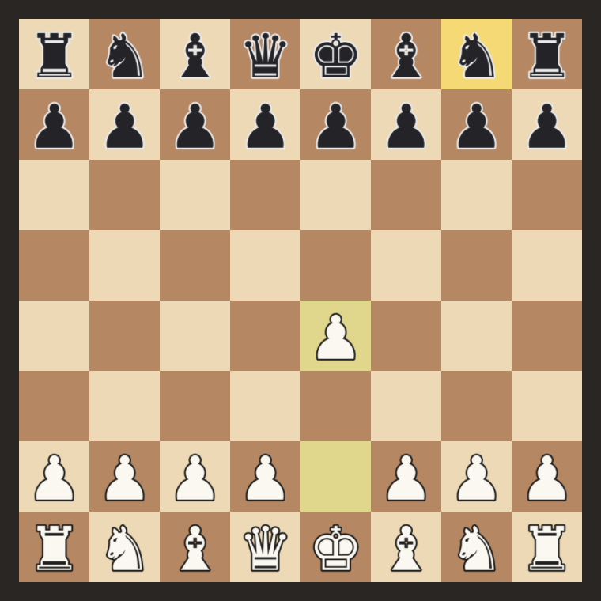

# Chess

A chess game and engine written from scratch in C++20, with a hand-written
OpenGL renderer on top of GLFW. Runs natively on macOS and Linux and in the
browser through WebAssembly.



## Build and run

### macOS (native)

```sh
xcode-select --install          # compiler, if you don't have it
brew install cmake

cmake -S . -B build
cmake --build build -j
./build/chess
```

CMake downloads GLFW and stb_image on the first configure, so you need an
internet connection the first time.

Controls: click a piece, then click a square. **F** flips the board, **R** resets,
**Esc** quits.

### Tests

```sh
cd build && ctest --output-on-failure     # or: ./build/engine_tests --deep
```

### Browser (WebAssembly)

Install the [Emscripten SDK](https://emscripten.org/docs/getting_started/downloads.html), then:

```sh
source /path/to/emsdk/emsdk_env.sh
emcmake cmake -S . -B build-web
cmake --build build-web -j
python3 -m http.server -d build-web 8000   # then open http://localhost:8000/chess.html
```

The page has to be served over HTTP; opening the .html file directly won't load the assets.

## How it's built

```
src/
  engine/      pure C++ chess logic, no graphics (board, FEN, move generation, search)
  gui/         GLFW window, OpenGL renderer, the playable board view
  main.cpp     window/context setup and the frame loop (native + Emscripten)
tests/         FEN round-trip and perft tests
tools/         script that generates the piece sprite atlas
assets/        pieces.png
```

- **Engine and GUI are separate.** The engine never includes graphics code, so it
  can be tested headlessly and later exposed as a UCI engine.
- **One rendering path for desktop and web.** The renderer sticks to the subset
  shared by OpenGL 3.3 core and OpenGL ES 3.0 (WebGL 2); only the GLSL `#version`
  line differs (`src/gui/gl.h`).
- **Batched 2D renderer.** Quads are collected into one vertex buffer and drawn
  with a single call per texture. Textures use premultiplied alpha so scaled
  sprites have clean edges.
- **HiDPI aware.** Drawing happens in window points; the viewport uses the real
  framebuffer size, so it's sharp on Retina screens.

## Roadmap

- [x] Window, renderer, board and pieces, click-to-move, board flip
- [x] Board representation and FEN parsing, with tests
- [ ] Legal move generation (castling, en passant, promotion) — pass every perft test
- [ ] Turn on legal-move enforcement in the GUI (`kEnforceLegalMoves` in `src/gui/game.cpp`)
- [ ] Undo/redo, drag-and-drop, promotion picker, check/checkmate display
- [ ] Text rendering (move list, coordinates, game result)
- [ ] Evaluation: material + piece-square tables
- [ ] Search: negamax + alpha-beta, iterative deepening, quiescence, move ordering
- [ ] Transposition table with Zobrist hashing
- [ ] Run search on a background thread (Web Worker on the web) so the UI never freezes
- [ ] Bitboards for speed
- [ ] UCI mode: test against other engines and estimate Elo

## Credits

Piece sprites are rendered from the DejaVu Sans font (`tools/make_piece_atlas.py`).
GLFW (zlib license) and stb_image (public domain / MIT) are downloaded at build time.
